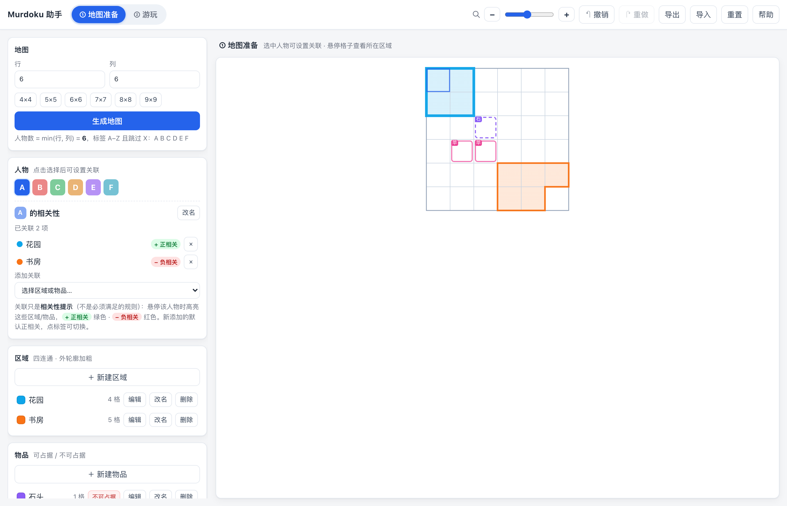
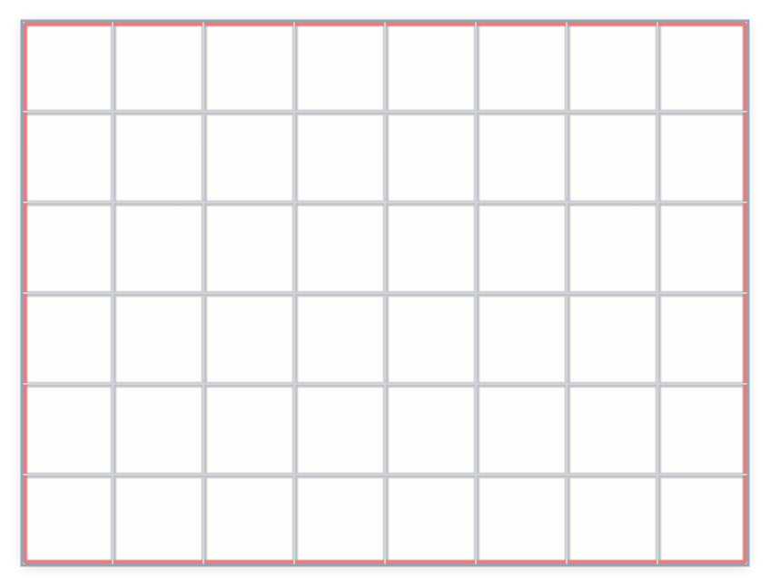
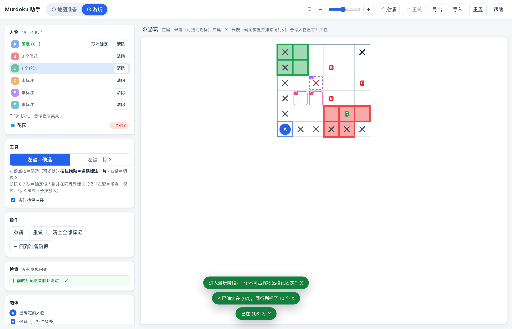

# Murdoku 助手

一个纯前端的本地小工具，用来辅助玩 **Murdoku**（类似 N 皇后 + 数独约束的推理游戏）：先在「地图准备阶段」把题目网格、区域、物品和人物关联搭出来，再在「游玩阶段」用候选、X 标记和长按确定来推理。

无需构建、无需联网、没有后端：直接双击 `index.html` 就能用。







## 快速开始

```bash
# 方式一：直接打开（推荐，脚本用的是普通 <script>，file:// 也能跑）
open index.html

# 方式二：起个本地静态服务（Node 内置模块实现，零依赖，不需要装依赖）
pnpm run serve             # http://127.0.0.1:8123
node scripts/serve.js 9000 # 换端口
```

## 底图（把网格对到地图上）

如果你手上有题目的图片或 PDF（扫描件、截图、导出的题目），可以把它**衬在网格下方**，再调整网格去匹配。「底图」卡片就在准备阶段侧栏的**最上面**：

1. 准备阶段 → 「底图」卡片 → **导入图片或 PDF**。图片会自动缩放到合适大小、压到合理体积；PDF 会渲染成位图（多页可选页）。
2. 勾上「**对齐底图**」，然后（**对齐时缩放只作用于网格**：即使底图已经「裁切绑定」过，抓手和 ± 也不会带着底图一起缩放，否则相对关系不变、就对不上了；退出对齐后恢复绑定缩放）：
   - **拖动**棋盘任意位置 = 移动网格
   - 拖网格**右下角的方形手柄** = 等比缩放网格（左上角不动）
   - **方向键**微调 1px，**Shift + 方向键** 10px
   - 用「底图透明度 / 底图缩放」调节观感；「适应窗口」让底图铺满可视区。**底图缩放可按 0.1% 精调**（滑块步长 0.1%，`−` / `+` 按钮各 0.1%、按住 Shift 是 1%），数值显示到一位小数；对不齐时别用鼠标拖滑块，用按钮或方向键点到位即可
3. 对好之后取消勾选，继续画区域 / 物品。（**没裁切时**改底图缩放会让相对位置变化，需要重新对一次。）

### 裁切到网格（图片与网格绑定缩放）

对好之后点「**✂ 裁切到网格**」：

- 底图按**网格外框**（四周留 16px 边距）裁掉多余部分，画面上只剩题目本体。裁切不改变对齐关系——网格相对底图的位置一模一样。
- 裁完 `bg.bound` 置真，**图片和网格就绑定了**：之后用顶栏 🔍 缩放时，`cellSize`（格子）、`bg.scale`（底图）、`grid.x/y`（网格偏移）**同倍变化**，对好的位置不会散。
- 裁切走 `store.commit`，算一次可撤销的操作（Ctrl/⌘+Z 可回退）。
- **没裁切过**时缩放只动格子、底图不动——那正是「对齐」需要的自由度。

底图数据存在浏览器本地（和存档分开，避免每次操作都重写几 MB），**导出 JSON 时会一并带上**，分享给别人也能看到底图。

## PDF 摘录悬浮窗（右侧）

Murdoku 的 PDF 里除了地图页，常常还有一页写着**人物 / 物品的具体信息**。右侧的「**PDF 摘录**」面板让你把那一块单独截出来钉住，游玩时一边看题一边对照：

- **和自己的文件、自己的页码**——与底图完全独立，可以是另一份 PDF，也可以和地图不在同一页。用 ◀ ▶ 翻页。
- 在页面上**拖一个矩形**，松手即截成一张卡片钉在面板下方；**可截多张**，每张标题栏右上角的 ✕ 单独删除，或「清空卡片」全清。
- **导航缩略图（minimap）**：卡片右侧浮出一张「整张摘录」的小图，蓝框标出现在看的是哪一块；在 minimap 上**点一下或按住拖动**即可直接跳过去。内容没超出卡片时它会自动隐藏，不占地方。
- 可**缩放**：标题栏 `−` / `+` 在 50%–400% 之间调整，点中间的百分比还原 100%。放大后**按住卡片拖动可以平移**。
- 卡片**按住标题栏拖动可以调整顺序**（左侧竖点手柄是拖拽区），顺序会存下来。
- 卡片多了**卡片区自己滚动**，不会顶出面板；顶部的 **PDF 缩略图可以折叠**（标题栏的 ∨ 按钮），把空间让给卡片。这两项状态都会记住。
- 面板可**收起**（点**面板左侧的箭头标签**），收起后只剩窄标签，角标显示卡片数量。
- 卡片与折叠状态存在 `murdoku-helper.v1.snipPins` / `.snipUi` 两个独立 key 里，**不写进棋盘状态**，也不进撤销历史。
- 单张卡片最长边限制 1600px，超过 400KB 自动转 JPEG，避免撑爆 localStorage。

> 实现见 `js/snipper.js`；它复用 `panels.js` 暴露的 `MH.ensurePdfLib` / `MH.renderPdfPage`，没有另起一套 pdf.js。加载时只建 DOM、不碰 canvas——jsdom 下 `getContext` 会抛，而界面测试断言运行期无报错。

## ① 地图准备阶段

| 操作 | 说明 |
| --- | --- |
| 生成地图 | 填行 / 列后点「生成地图」。人物数 = **min(行, 列)**，标签按 A–Z 顺序并**跳过 X**（超过 25 人时自动用 AA AB … 继续，同样不含 X）。 |
| 新建区域 | 点「＋ 新建区域」→ 在棋盘上单击切换格子 / 按住拖动刷选 → 填名称 → 保存。区域必须**四连通**，不连通时保存按钮禁用，可用「只保留最大连通块」一键修复。区域外轮廓会用该区域的颜色**加粗描边**。**一个格子只属于一个区域**，重复选中时会从原区域移过来（草稿里会提示）。 |
| 新建物品 | 点「＋ 新建物品」→ 选格子 → 填名称 → 选**可占据**（人可放在这些格子上）或**不可占据**（人不能放上去；游玩阶段这些格子会固定显示红色 ✕）。物品格不要求连通，**一个格子也只能属于一个物品**。 |
| 人物编号 | 默认按 A–Z 顺序**跳过 X** 自动生成（超过 25 人续 AA、AB…）。在人物面板点「**改名**」可改成 1–4 个字符的任意编号，例如 `小明`；要求**互不重复**且**不含 X**（X 在棋盘上表示「不能放人」）。改完的编号会随存档保存、也能撤销。 |
| 人物关联 | 在上方人物条里点选一个人物，用**下拉框**选用要关联的区域或物品（选中的即建立关联，**默认正相关**）。已关联的条目上点标签可在**正相关 / 负相关**之间切换（**不会打乱列表顺序**），点 `×` 取消。区域/物品很多时不用一个个操作。 |

## ② 游玩阶段

左侧「人物」卡片是**紧凑网格**（每行 7 个），人多也不会拉成长条：24 人只占 4 行约 164px。每格显示人物编号，角标是**候选数**；**已确定**的人整格填成本人颜色并带 ✓。点格子切换当前人物，**详情与「取消确定 / 清除标记」只显示当前这一个**（旧版每人两个按钮，24 人时列表要 700px 以上）。悬停格子仍然联动棋盘高亮。

| 操作 | 说明 |
| --- | --- |
| 左键点按 | 给**当前人物**标注候选；再点一次取消。如果左键正处在「标 X」模式，**点另一个人会自动切回「候选」**——选人就是要标他的候选，省得误标一片 X（点当前人物自己不会改模式）。 |
| 按住拖动 | **连续标注一片格子**（候选或 X 都支持）。起点格决定方向：从空白格开始是「加」，从已有标记的格子开始是「擦」。整段拖动只算**一次撤销**。 |
| 右键 | 切换该格的 ✕（深黑，醒目表示这个格子不能放人）。也可以把左键模式切成「左键＝标 X」，此时左键也可以拖动连标，且**不会长按放人**。 |
| 长按 0.7 秒 | 格子中央出现**圆形进度条**，走满即把当前人物确定在该格，并自动在**同一行、同一列（除当前格）标 ✕**。只在「左键＝候选」模式下生效（避免和「标 X」冲突）。松开时不会误触发点击。 |
| 悬停格子 | 鼠标在网格里移动时，只把该格**所在区域的外框**加粗高亮（不填充格子，避免盖住候选和 ✕）；同时点亮它**所在行 / 列的提示条**（见下）。 |
| 行列候选提示 | **行统计在网格右边、列统计在网格下面**（画布只向右下延伸，左上角原点不动，不影响底图对位），显示这一行/列都有哪些人的候选；已确定的人用**实心**标出。鼠标在哪一格，对应行列就**点亮**。**行统计横排一行、列统计竖排一列**（一个标签一行，位置稳定）。统计条会**按内容自己变大**（行变宽、列变高）把标签尽量显示全，字号随格子缩放；只有长到上限还放不下时才折成 `+N`，`title` 里有完整名单。可在工具卡里关掉。 |
| 点行列统计里的人 | 点某个候选标签 = 「这一行/列就是他的」：**清掉这一行/列里其他人的候选，并把这一行/列里其余格子全部标 ✕**（只留下他自己的候选格不标）。别的行/列不受影响，整件事**只占一次撤销**。已经没得做时会提示并且不写历史。 |
| 悬停人物 | 棋盘上的圆形标记、候选小标签，或左侧人物条：把该人物关联的区域/物品**整块填充**高亮（**正相关绿色、负相关红色**），同时把他**自己的候选格**用本人颜色的描边顶出来 —— 同格里别人的候选会淡下去，一眼看清「他的候选都在哪」。 |
| 检查 | 实时列出**规则冲突**：同行同列、放在 ✕ 或不可占据物品上、无处可放、两人唯一候选撞车等。点问题条目可定位到对应格子。关联不作为规则校验。 |

## 界面

- **左侧面板宽度可调**：拖着侧栏与棋盘之间的竖条左右拖动即可，**最小 300px**（最宽给棋盘留出 360px）；双击竖条还原 372px。聚焦竖条后也能用 ← →（Shift 大步）微调，`Home` / `End` 到最小 / 最大。宽度只记在本地，不进存档也不进撤销。

## 其他

- **撤销 / 重做**：`⌘Z` / `⇧⌘Z`（Windows：`Ctrl+Z` / `Ctrl+Y`）。所有改动（区域、物品、关联、候选、X、确定）都可撤销。
- **存档**：每次改动自动写入浏览器 localStorage；「导出 / 导入 JSON」可备份或把题目发给别人。
- **底图**：导入图片 / PDF 衬在网格下方，用「对齐底图」拖网格对位（见上文）。
- **缩放**：顶栏 🔍 旁的 `−` / `+` 按钮（步进 6px，到极限自动禁用）或拖动中间的滑块，调整每格显示的像素大小（12–160px）；大棋盘可在棋盘区域滚动。
- 顶栏「重置」只清空内容，行/列不变。

## 设计取舍

- **一个格子只属于一个区域、也只属于一个物品**（但区域与物品是两套独立归属，可以叠在同一格上：既有区域底色又有物品边框）。重复选中时会从原归属移过来，导入 JSON 时同样强制。区域必须四连通，物品不要求。
- 人物数量固定为 `min(行, 列)`，与规则一致，因此不能手工增删人物。
- 「不可占据物品格」在游玩阶段由程序**派生**为固定 ✕，不属于用户标记，不能取消、不能放人、不能作候选。
- 长按确定产生的行列 ✕ 是**已确定人物的推论**：一个交叉格可能同时被多个人的行列排除，只有这些人都取消确定后它才会消失；因此不能右键单独擦掉（会明确提示原因），取消那个人的确定位置即可解除。
- 导入 JSON 时会自动把行列 ✕ 重算成自洽状态（补齐缺失的排除、清掉无主的残留），并清洗非法 id / 颜色。
- 「设置」（缩放、左键模式、实时检查开关）不进撤销历史：撤销内容改动不会顺手改掉这些。
- 人物与区域/物品的**关联只是相关性提示**（用于悬停高亮、辅助推理），**不是必须满足的规则**，校验不会因关联不符报错。
- 校验只提示冲突，不会阻止你做出违反规则的操作（除了明确不可能的：同一个格放两个人、同行同列放两个人、在 ✕ 或不可占据格放人）。

## 开发

包管理用 **pnpm**（`packageManager: pnpm@11.28.5`，锁文件是 `pnpm-lock.yaml`）。

```bash
pnpm install          # 只装测试用的 jsdom；运行网页本身零依赖
pnpm test             # 124 个用例：纯逻辑 + 状态层 + jsdom 界面集成
pnpm run test:core    # 只跑不需要 DOM 的逻辑测试
pnpm run serve        # 本地静态服务
pnpm run vendor:pdfjs # 重新打包 pdf.js（升级 pdfjs-dist 后用）

# 可选：真实浏览器端到端（拖拽刷格、长按进度条、刷新后恢复等必须真机验证的部分）
pnpm add -D playwright && pnpm exec playwright install chromium
pnpm run test:browser
```

> 这个 pnpm 版本默认把 content-addressable store 放在项目内的 `.pnpm-store/`（已 gitignore）。
> 想让所有项目共用一个全局 store，可以设一次 `pnpm config set store-dir ~/Library/pnpm/store`。

```
index.html          页面结构 + 帮助弹窗
css/styles.css      样式
js/core.js          纯逻辑：网格/连通性/区域轮廓/人物/游玩规则/校验/序列化（Node 可直接 require）
js/store.js         状态容器：提交-回滚、撤销重做、localStorage 持久化、导入导出
js/board.js         棋盘渲染（DOM 网格 + SVG 轮廓层）与全部指针交互
js/panels.js        侧栏两个阶段的界面、顶栏同步、全局动作分发
js/app.js           MH 命名空间、渲染编排、提示条、启动
vendor/pdfjs/       打包好的 pdf.js（经典 IIFE + 内联 worker，file:// 下也能渲染 PDF）
scripts/serve.js    本地静态服务器（零依赖，只用 node:http / node:fs）
scripts/vendor-pdfjs.js  重新生成 vendor/pdfjs（pnpm run vendor:pdfjs）
tests/*.test.js     node:test 用例（core / store / ui-jsdom）
tests/e2e.browser.js 可选的真实 Chromium 端到端演练
```

`js/core.js` 不依赖 DOM，可以单独 `require()` 用来写脚本校验自己的题目。
